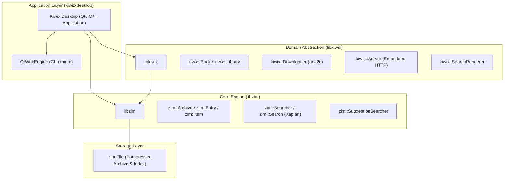
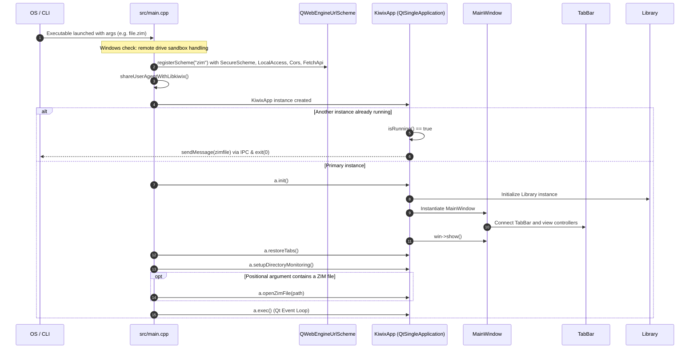
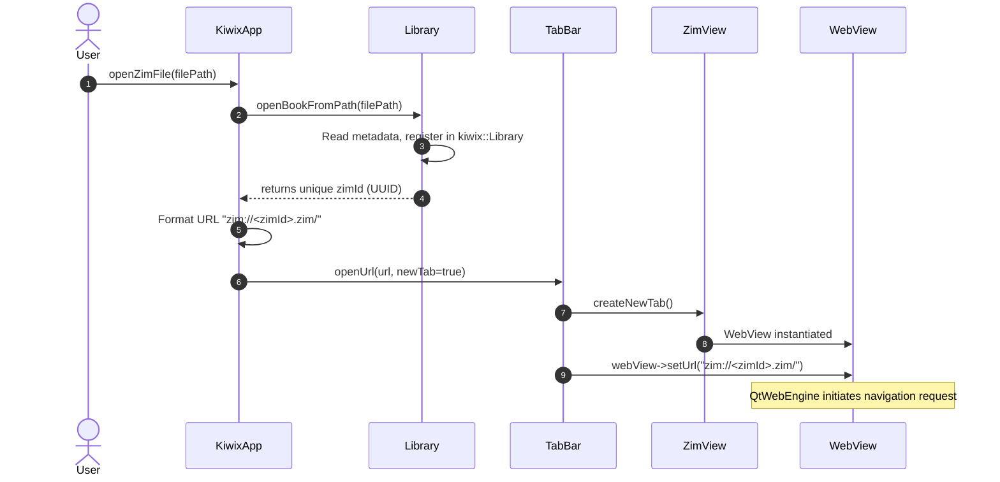
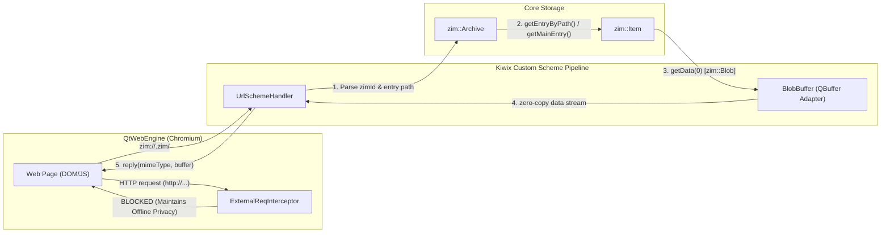
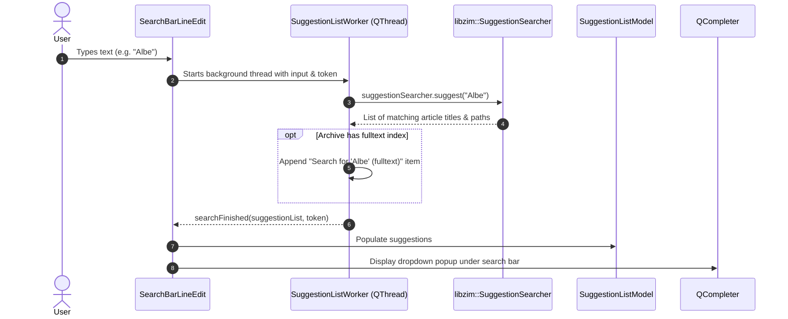

# Kiwix Desktop Architecture and Contributor Guide

Welcome to the Kiwix Desktop architecture guide. This document is designed for new and existing contributors who want to understand how Kiwix Desktop is organized, how data flows through the application, and how its key subsystems interact.

---

## Table of Contents

1. [High-Level Ecosystem](#1-high-level-ecosystem)
2. [Application Startup and Lifecycle](#2-application-startup-and-lifecycle)
3. [Main UI Components and Layout](#3-main-ui-components-and-layout)
4. [Opening and Displaying a ZIM File](#4-opening-and-displaying-a-zim-file)
5. [The `zim://` Protocol and WebEngine Integration](#5-the-zim-protocol-and-webengine-integration)
6. [Search and Suggestion Architecture](#6-search-and-suggestion-architecture)
7. [Library Management and Downloads](#7-library-management-and-downloads)
8. [Debugging ZIM Rendering and WebEngine](#8-debugging-zim-rendering-and-webengine)
9. [Contributor Cheat Sheet: Where to Start](#9-contributor-cheat-sheet-where-to-start)

---

## 1. High-Level Ecosystem

Kiwix Desktop sits at the top of a layered stack of open-source libraries and standards:



### Roles and Responsibilities

| Component | Responsibility |
| :--- | :--- |
| **ZIM File** | Open standard file format storing compressed offline web content (HTML, images, CSS, JavaScript, video), book metadata, and optional Xapian full-text search indexes. |
| **`libzim`** | Low-level C++ library providing random read access to ZIM archives, block decompression (Zstandard, LZMA), entry retrieval, title prefix suggestions, and full-text search querying. |
| **`libkiwix`** | Mid-level C++ library providing higher-level Kiwix abstractions: manages collections of books (`kiwix::Library`), bookmarks, OPDS online catalog parsing, search result rendering into HTML, file downloads via aria2 (`kiwix::Downloader`), and the embedded `kiwix-serve` HTTP server. |
| **`kiwix-desktop`** | The native Qt6 desktop GUI application. Manages windows, tabs, sidebars, settings, and bridges QtWebEngine (Chromium) to `libzim` via custom URL schemes (`zim://`). |

---

## 2. Application Startup and Lifecycle

The application lifecycle begins in `src/main.cpp` and transitions into `KiwixApp` and `MainWindow`.



### Key Initialization Milestones

1. **Early WebEngine Scheme Registration (`src/main.cpp`):**
   QtWebEngine requires custom URL schemes to be registered **before** the `QApplication` instance is constructed:
   ```cpp
   QWebEngineUrlScheme scheme("zim");
   scheme.setSyntax(QWebEngineUrlScheme::Syntax::Host);
   scheme.setFlags(QWebEngineUrlScheme::SecureScheme
                 | QWebEngineUrlScheme::LocalAccessAllowed
                 | QWebEngineUrlScheme::CorsEnabled
                 | QWebEngineUrlScheme::FetchApiAllowed);
   QWebEngineUrlScheme::registerScheme(scheme);
   ```
   * `FetchApiAllowed` (Qt 6.6+) is critical for articles relying on modern JavaScript `fetch()` or `XMLHttpRequest` calls against `zim://` resources.
2. **User-Agent Synchronization (`src/useragent.cpp`):**
   Calls `shareUserAgentWithLibkiwix()` before any downloader is created so aria2 and OPDS requests carry the desktop client user agent.
3. **Single Application Check (`QtSingleApplication`):**
   `KiwixApp` inherits `QtSingleApplication`. If a second instance is started (e.g., double-clicking a `.zim` file in the OS file explorer while Kiwix is open), the second process forwards the argument string to the primary instance over a local socket and terminates immediately.
4. **Window and Tab Setup (`src/kiwixapp.cpp` & `src/mainwindow.cpp`):**
   `KiwixApp::init()` instantiates `ContentManager`, builds global actions, applies `style.css` and bundled fonts (Selawik), instantiates `MainWindow`, and connects signals.
5. **Session Restore & Directory Monitoring:**
   `restoreTabs()` inspects `QSettings` (`reopenTabList`) and reopens tabs from the previous session if configured. `setupDirectoryMonitoring()` registers monitored directories to auto-detect new ZIM downloads.

---

## 3. Main UI Components and Layout

The user interface follows a composite widget hierarchy anchored by `MainWindow`:

```
+-----------------------------------------------------------------------------------+
| MainWindow                                                                        |
| +-------------------------------------------------------------------------------+ |
| | TopWidget (Navigation buttons, SearchBar, Sidebar toggles, Menu button)      | |
| +-------------------------------------------------------------------------------+ |
| | TabBar (Tabs, scroll arrows, "+" new tab button)                              | |
| +-----------------------------------------------------+-------------------------+ |
| | Central Stacked Widget (mp_stackedWidget)           | Collapsible Sidebar     | |
| |                                                     | (QStackedWidget)        | |
| | - ContentManagerView (Tab 0: Library catalog)       |                         | |
| |   OR                                                | - ContentManagerSide    | |
| | - ZimView (Tabs 1..N: Article view)                 |   (Filter categories)   | |
| |   +-- WebView (QWebEngineView)                      |                         | |
| |   +-- FindInPageBar (Ctrl+F search bar)             | - TableOfContentBar     | |
| |   +-- TextToSpeechBar (TTS voice controls)          |   (Article outline tree)| |
| |   OR                                                |                         | |
| | - SettingsView (Preferences tab)                    | - ReadingListBar        | |
| |                                                     |   (Bookmarks manager)   | |
| +-----------------------------------------------------+-------------------------+ |
+-----------------------------------------------------------------------------------+
```

### Component Breakdown

| Class | Source Files | Description |
| :--- | :--- | :--- |
| `MainWindow` | `src/mainwindow.h`, `src/mainwindow.cpp` | Top-level window hosting the toolbar, tab bar, central stack, and collapsible dock sidebar. |
| `TopWidget` | `src/topwidget.h`, `src/topwidget.cpp` | Navigation toolbar holding Back/Forward history buttons, the `SearchBar`, fullscreen toggle, TOC toggle, and main menu. |
| `TabBar` | `src/tabbar.h`, `src/tabbar.cpp` | Custom tab bar controlling the central stacked widget. Manages tab lifecycles, tab reordering, close buttons, and tab titles. |
| `ZimView` | `src/zimview.h`, `src/zimview.cpp` | Compound container for an active article tab. Houses the `WebView`, `FindInPageBar`, and `TextToSpeechBar`. |
| `WebView` | `src/webview.h`, `src/webview.cpp` | `QWebEngineView` subclass that loads `zim://` URLs, handles zoom settings, and connects `QWebChannel`. |
| `WebPage` | `src/webpage.h`, `src/webpage.cpp` | `QWebEnginePage` subclass configured with `KProfile`. Routes external link clicks to the default OS browser. |
| `SearchBar` | `src/searchbar.h`, `src/searchbar.cpp` | Search line edit with live autocompletion driven by `zim::SuggestionSearcher` in a background worker thread. |
| `ContentManager` | `src/contentmanager.h`, `src/contentmanager.cpp` | Controller managing the local library and remote OPDS catalogs, filtering, and downloads. |
| `ContentManagerView` | `src/contentmanagerview.h`, `src/contentmanagerview.cpp` | `QListView` displaying local and available online ZIM books. |
| `ContentManagerSide` | `src/contentmanagerside.h`, `src/contentmanagerside.cpp` | Filter sidebar for the library view (language, category, content size). |
| `TableOfContentBar` | `src/tableofcontentbar.h`, `src/tableofcontentbar.cpp` | Tree view displaying the heading outline of the current article, synced via `QWebChannel`. |
| `ReadingListBar` | `src/readinglistbar.h`, `src/readinglistbar.cpp` | Sidebar listing bookmarks and reading history, supporting HTML/JSON import and export. |

---

## 4. Opening and Displaying a ZIM File

When a user opens a ZIM file (via file dialog, command line, or recent files), the execution proceeds through the following path:



1. **Path to Book (`Library::openBookFromPath`):**
   `Library` creates a `kiwix::Book` from the file path, stores it in `kiwix::Library`, and returns the book's unique identifier (`zimId`).
2. **URL Construction:**
   The URL is synthesized as `zim://<zimId>.zim/`.
3. **Tab Allocation:**
   `TabBar::openUrl` creates a new `ZimView` (or reuses the current tab if requested) and sets the URL on its embedded `WebView`.
4. **Rendering Initiation:**
   `WebView` passes the URL to `WebPage`, triggering the `QWebEngineUrlSchemeHandler` registered on the `"zim"` protocol.

---

## 5. The `zim://` Protocol and WebEngine Integration

Kiwix Desktop completely sandboxes article rendering offline using a custom `zim://` scheme handler and request interceptors.



### 5.1 URL Structure

Kiwix Desktop recognizes three types of hosts on the `zim://` scheme:

1. **Content URLs:** `zim://<zimId>.zim/<entry_path>`
   * Represents articles, images, stylesheets, or scripts inside the ZIM archive.
   * Example: `zim://a1b2c3d4.zim/A/Physics.html`
   * If the path is empty or `/`, `UrlSchemeHandler` retrieves `archive->getMainEntry()`.
2. **Metadata URLs:** `zim://<zimId>.meta/<type>`
   * Used for book artwork and favicons.
   * Example: `zim://a1b2c3d4.meta/favicon` retrieves the 48px book illustration.
3. **Search URLs:** `zim://<zimId>.search?pattern=<query>`
   * Triggers full-text search within that archive.
   * Handled by executing `zim::Search` and rendering the results into an HTML page with `kiwix::SearchRenderer`.

### 5.2 Zero-Copy Memory Bridge (`BlobBuffer`)

To avoid copying multi-megabyte media or large articles in memory, `UrlSchemeHandler` uses [`BlobBuffer`](file:///c:/kiwix-desktop/src/blobbuffer.h):
* `zim::Item::getData()` returns a `zim::Blob` (a reference-counted memory-mapped slice from `libzim`).
* `BlobBuffer` subclasses `QBuffer` and passes `blob.data()` and `blob.size()` directly without heap reallocations.
* `BlobBuffer` is bound to the `QWebEngineUrlRequestJob::destroyed` signal, ensuring memory is freed once Chromium finishes reading the stream.

### 5.3 Offline Security and Isolation

* **`ExternalReqInterceptor` (`src/kprofile.cpp`):**
  Installs a `QWebEngineUrlRequestInterceptor` on `KProfile`. Any subresource request (image, script, iframe, font) not starting with `zim://` is immediately blocked. This prevents embedded content from tracking users or leaking IP addresses.
* **`WebPage::acceptNavigationRequest` (`src/webpage.cpp`):**
  If a user clicks an external link (`http://` or `https://`), Kiwix prevents the embedded view from loading it and instead delegates it to the desktop's default external browser via `QDesktopServices::openUrl()`.

### 5.4 DOM-to-C++ Bridge (`QWebChannel`)

For interactive features like the **Table of Contents**:
1. At page creation, `KProfile` injects `qwebchannel.js` and `headerAnchor.js` into the `UserWorld`.
2. `headerAnchor.js` queries `<h1>` through `<h6>` tags in the document and builds a JSON outline.
3. `KiwixWebChannelObject` receives the headers over `QWebChannel` and emits `headersChanged`.
4. `TableOfContentBar::setupTree` populates a `QTreeWidget` from this outline.
5. When the user clicks an entry in the outline, a signal fires through `QWebChannel` back to the page script to scroll the target heading into view.

---

## 6. Search and Suggestion Architecture

Search in Kiwix Desktop operates at two levels: **prefix autocompletion** and **full-text search**.



* **Non-blocking UI:** Suggestions run in [`SuggestionListWorker`](file:///c:/kiwix-desktop/src/suggestionlistworker.h), which subclasses `QThread`. Typing remains responsive even when querying massive multi-gigabyte ZIM files.
* **Full-Text Search:** If the user selects the fulltext search item or presses Enter on a search query, Kiwix navigates to `zim://<zimId>.search?pattern=<query>`. `UrlSchemeHandler::handleSearchRequest` queries Xapian via `libzim`, passes the result set to `kiwix::SearchRenderer`, and outputs a paginated HTML result list.

---

## 7. Library Management and Downloads

Library catalog and download features are coordinated through `ContentManager` (`src/contentmanager.cpp`):

* **Local vs. Remote:** `ContentManager` maintains lists of both locally available ZIMs and remote books available for download via OPDS feeds (`OpdsRequestManager`).
* **Download Engine:** Inherits `DownloadManager` (`src/downloadmanagement.cpp`), wrapping `kiwix::Downloader` (backed by an external `aria2c` process or embedded `libtorrent` if enabled).
* **Directory Monitoring:** `QFileSystemWatcher` monitors user-configured download directories and automatically imports completed `.zim` files.
* **Embedded Server (`LocalKiwixServer`):** Kiwix Desktop can share books over the local network by wrapping `kiwix::Server` (`src/localkiwixserver.cpp`), providing a local web server interface at `http://localhost:<port>`.

---

## 8. Debugging ZIM Rendering and WebEngine

Because Kiwix Desktop uses Chromium via QtWebEngine, you can use the full power of Chrome DevTools to inspect and debug HTML rendering, JavaScript execution, and CSS styling.

### 8.1 Enabling Remote DevTools

1. **Launch Kiwix Desktop with the debugging port flag:**
   * **Linux:**
     ```bash
     QTWEBENGINE_REMOTE_DEBUGGING=12345 kiwix-desktop
     ```
   * **Windows (PowerShell):**
     ```powershell
     $env:QTWEBENGINE_REMOTE_DEBUGGING="12345"; .\kiwix-desktop.exe
     ```
2. **Open DevTools in your browser:**
   * Open any Chromium-based browser (Chrome, Chromium, Edge, Brave).
   * Navigate to: `http://localhost:12345`
   * You will see an inspection page listing all active WebEngine web views. Click on the tab corresponding to your open ZIM article.

### 8.2 What You Can Inspect

* **Elements Tab:** Inspect the DOM hierarchy of the article, modify CSS properties live, and test layout changes.
* **Network Tab:** Verify that subresource requests are properly routed to `zim://...`. Look for any blocked requests or failed assets.
* **Console Tab:** View JavaScript runtime errors, debug injected scripts (`headerAnchor.js`, `qwebchannel.js`), and manually execute JavaScript expressions in the context of the page:
  ```javascript
  console.log(window.location.href);
  ```
* **Sources Tab:** Place breakpoints in JavaScript inside the ZIM file or in Kiwix's injected scripts.

### 8.3 Common Rendering Issues and Tips

* **Missing Images / Assets:** Check the Network tab. If assets show 404/UrlNotFound, verify whether the article is using relative paths or trying to fetch an absolute path that does not exist in the ZIM namespace.
* **Fetch / XHR Errors:** In Qt 6.6+, custom schemes must have `FetchApiAllowed` set in `QWebEngineUrlScheme` (in `main.cpp`). Without this, scripts using `fetch()` on `zim://` URLs fail with CORS or network errors.
* **Blocked External Resources:** Remember that `ExternalReqInterceptor` explicitly drops any requests that do not begin with `zim://`. External fonts, analytics, or external CDN scripts will intentionally not load.

---

## 9. Contributor Cheat Sheet: Where to Start

Use this quick-reference table to find the right files when working on a bug or new feature:

| Task / Area | Primary Files to Inspect |
| :--- | :--- |
| **Startup flags, command-line arguments, scheme setup** | `src/main.cpp`, `src/kiwixapp.cpp` |
| **Window layout, sidebars, main menus** | `src/mainwindow.cpp`, `src/mainwindow.h`, `ui/mainwindow.ui` |
| **Tab lifecycle, tab ordering, tab close behavior** | `src/tabbar.cpp`, `src/tabbar.h` |
| **Web view behavior, page navigation, external links** | `src/webview.cpp`, `src/webpage.cpp`, `src/kprofile.cpp` |
| **`zim://` protocol handling, MIME types, ZIM decompression** | `src/urlschemehandler.cpp`, `src/blobbuffer.h` |
| **Search input, search suggestions, autocompletion** | `src/searchbar.cpp`, `src/suggestionlistworker.cpp`, `src/suggestionlistmodel.cpp` |
| **Full-text search rendering** | `src/urlschemehandler.cpp` (`handleSearchRequest`) |
| **Bookmarks and reading list** | `src/readinglistbar.cpp`, `src/library.cpp` |
| **Table of Contents generation & DOM anchors** | `src/tableofcontentbar.cpp`, `resources/js/headerAnchor.js`, `src/kiwixwebchannelobject.h` |
| **Library catalog view, book cards, filtering** | `src/contentmanager.cpp`, `src/contentmanagerview.cpp`, `src/contentmanagerside.cpp` |
| **ZIM file downloads (aria2 / libtorrent)** | `src/downloadmanagement.cpp`, `src/contentmanager.cpp` |
| **Embedded local HTTP server (`kiwix-serve`)** | `src/localkiwixserver.cpp`, `ui/localkiwixserver.ui` |
| **Settings, dark mode, persistent preferences** | `src/settingsmanager.cpp`, `src/settingsview.cpp`, `ui/settings.ui` |
